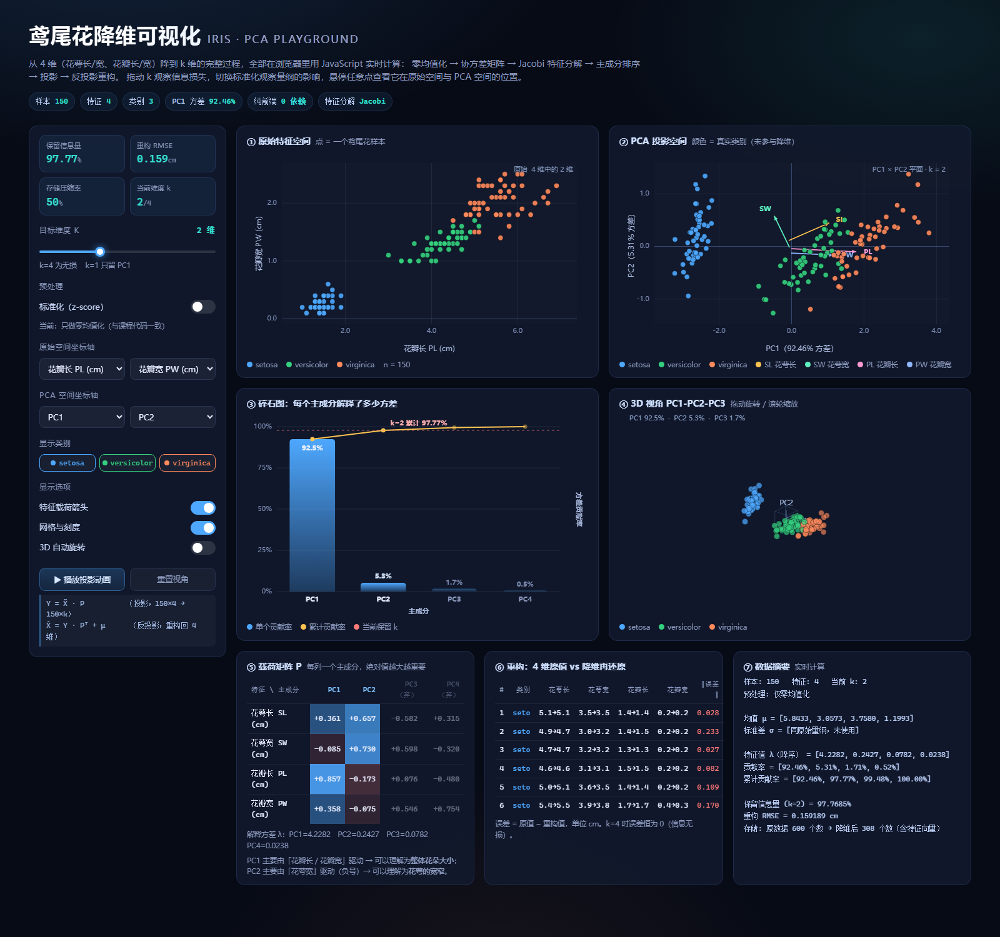

# 鸢尾花 PCA 降维实践

> 课程原始文件：`pca降维.ipynb`（原样保留，未做任何修改）
>
> 本仓库完成三件事：**① 跑通「实践 1：鸢尾花降维」并逐行注释；② 学习原始代码用到的工具函数、写范例、整理学习笔记；③ 用 HTML5 做一个可交互的鸢尾花降维可视化页面。**

---

## 一、交付物

| 作业要求 | 交付文件 | 说明 |
| --- | --- | --- |
| （1）跑通实验 + 详细注释 | **`01_鸢尾花PCA_注释版.ipynb`** | 保留原实现的全部逻辑与函数名，逐行中文注释 + 每步数学校验（`np.allclose` 全为 True），并修掉 NumPy 2.x 下会崩溃的 `np.mat` 写法；含原版输出复现、修正版可视化、与 sklearn 交叉验证 |
| （2）工具函数学习笔记 | **`02_PCA工具函数学习笔记.ipynb`** | 14 章：`np.mean / np.tile / np.cov / np.linalg.eig&eigh / np.argsort / 矩阵乘法 / dtype / matplotlib / OpenCV` 逐个讲透 + 可运行范例 + 综合范例（手算 PCA、图片 PCA 压缩、SVD 版 PCA）+ 速查表 + 报错对照表 |
| （3）HTML5 可视化 | **`03_iris_pca_可视化.html`** | 单文件、零依赖、离线可用；浏览器内用 JavaScript 真算 PCA（Jacobi 特征分解），可调 k、切换标准化、悬停查看样本、含碎石图 / 双标图 / 3D 视角 / 重构对比表 |
| 加分 | `screenshots/`、`images/`、`build/` | 页面与图表截图；notebook 生成的图；notebook 与页面的**生成/校验脚本**（可复现、可验证） |

---

## 二、快速开始

```bash
# 0. 环境（Windows / Python 3.13 实测）
pip install -r requirements.txt

# 1. 看注释版实验（已带输出，直接打开即可；如需重跑）
jupyter nbconvert --to notebook --execute --inplace "01_鸢尾花PCA_注释版.ipynb"

# 2. 看学习笔记（同上）
jupyter nbconvert --to notebook --execute --inplace "02_PCA工具函数学习笔记.ipynb"

# 3. 看可视化：直接用浏览器打开，无需服务器
#    Windows:  start "" "03_iris_pca_可视化.html"
```

> 页面支持 URL 参数，方便分享某个状态，例如：
> `03_iris_pca_可视化.html?k=3&std=1`（保留 3 维 + 标准化）、
> `?rawX=0&rawY=1&pcX=0&pcY=2`（原始空间看花萼长×花萼宽，PCA 空间看 PC1×PC3）。

---

## 三、实验结论（`01` 里的真实运行结果）

| 指标 | 数值 |
| --- | --- |
| 均值向量 μ | `[5.8433, 3.0573, 3.7580, 1.1993]` |
| 协方差矩阵特征值 | `[4.2282, 0.2427, 0.0782, 0.0238]` |
| 单个主成分贡献率 | `92.46% / 5.31% / 1.71% / 0.52%` |
| 累计贡献率 | `92.46% → 97.77% → 99.48% → 100%` |
| k=2 保留信息量 | **97.77%**（只丢 2.23%） |
| 重构 RMSE | k=1 `0.2926` → k=2 `0.1592` → k=3 `0.0769` → k=4 `0`（cm） |
| 与 sklearn 对照 | 特征值 / 贡献率**完全一致**，投影结果**仅可能差一个负号**（特征向量符号不唯一），`|corr| = 1` |

**一句话**：鸢尾花的 4 个特征高度相关，本质只有约 2 个独立方向，降到 2 维几乎不损失信息，
且三类样本在 PC1–PC2 平面上依然清晰可分（setosa 尤其干净）。

图片 PCA 压缩（`02` 第 11 章，示例图 427×640 灰度）：

| 目标 | k | 压缩率 | PSNR |
| --- | --- | --- | --- |
| 保留 90% 能量 | 17 | 6.6% | 20.60 dB |
| 保留 95% 能量 | 53 | 20.7% | 23.61 dB |
| 保留 99% 能量 | 171 | 66.8% | 30.63 dB |
| 固定 k=80 | 80 | 31.2% | 25.22 dB |

> 结论：能量保留率 ≠ 视觉质量。人眼对边缘/细节敏感，99% 能量时画面仍有细微模糊。

---

## 四、可视化页面功能一览



| 区域 | 内容 |
| --- | --- |
| ① 原始特征空间 | 任选两个原始特征作轴，按真实类别着色 |
| ② PCA 投影空间 | 任选两个主成分作轴，叠加**双标图箭头**（4 个原始特征的载荷，颜色区分） |
| ③ 碎石图 | 单个贡献率柱 + 累计贡献率折线 + 当前 k 参考线 |
| ④ 3D 视角 | PC1–PC2–PC3 线框立方体，可拖动旋转 / 滚轮缩放 / 自动旋转 |
| ⑤ 载荷矩阵 | 逐项热力着色，可看出「PC1≈花朵整体大小，PC2≈花萼宽窄」 |
| ⑥ 重构对比表 | 原值 → 重构值，附欧氏误差 |
| ⑦ 数据摘要 | 均值、标准差、特征值、贡献率、RMSE、存储压缩率，实时计算 |
| 交互 | k 滑块（1~4）、标准化开关、类别显隐、轴选择、箭头/网格/自动旋转开关、投影动画、悬停 tooltip、重置视角 |

### 关键实现

- **PCA 真的在算**：页面内实现中心化 → 协方差 → **Jacobi 特征分解**（对称矩阵）→ 降序排序 → 符号规范化；
- **没有引用任何 CDN/网络资源**，断网双击即可运行；
- Canvas 按 `devicePixelRatio` 缩放，高清屏不糊；窗口尺寸变化自动重绘。

### 自检

`build/verify_html.js` 会把页面里的 PCA 内核与内嵌数据抽出来独立运行，和 NumPy 结果对拍：

```text
$ node build/verify_html.js
[1] <script> 语法检查        —— 2 个 script 块语法 OK
[2] 抽取 PCA 内核与数据      —— 150 样本 × 4 特征，三类各 50
[3] 与 numpy 期望值对拍      —— 特征值 / 贡献率 / 主成分 / 得分 误差 < 1e-12；
                               主成分两两正交；RMSE 随 k 单调下降；k=4 重构无损
[4] 页面结构自检            —— 16 个关键元素、4 个 canvas、无外链
==== 结果: 全部通过 ✅ ====
```

---

## 五、原始代码的问题与修复（`01` 第 2 章有完整表格）

| # | 原始写法 | 问题 | 修复 |
| --- | --- | --- | --- |
| 1 | `np.mat(newdata) * fvectormat.T + mean_vector` | **NumPy ≥ 2.0 直接崩溃**：`np.mat`/`np.matrix` 已被移除 | 改用 `newdata @ fvectormat.T + mean_vector` |
| 2 | `print(... % fvector)` | 打印的是 4×4 全部特征向量，不是取出的 4×2，容易被误认为 k 没生效 | 改打印 `fvectormat` |
| 3 | `show_picture(standdata, newdata)` | 把「中心化后的原始空间」和「PCA 空间」两种不同刻度叠在一张图上，说明不了降维效果 | 换成三类着色 + 双标图 + 碎石图 + 误差曲线 |
| 4 | `np.linalg.eig` | 特征值无序、非对称时可能给复数 | 保留原写法并补充 `eigh` 推荐写法 |
| 5 | `stand_data` 只做零均值化 | 名字像标准化，实则只 centering（鸢尾花量纲相同，影响不大） | 保留原逻辑，并在第 7 章说明何时必须 `/std` |
| 6 | 图像实践读 `banana.jpg` | 仓库里没有这张图 | 优雅降级：存在就用，否则用 `sklearn.datasets.load_sample_image('china.jpg')` |

---

## 六、目录结构

```
PCA/
├── pca降维.ipynb                  原始课程文件（保持原样）
├── 01_鸢尾花PCA_注释版.ipynb        ← 交付物 (1)
├── 02_PCA工具函数学习笔记.ipynb      ← 交付物 (2)
├── 03_iris_pca_可视化.html          ← 交付物 (3)
├── requirements.txt
├── images/                        notebook 运行生成的图
│   ├── 01_original_show_picture.png   原版 show_picture 的复现（用来说明它的问题）
│   ├── 02_pca_iris_2d.png             修正版：原始空间 / PCA+双标图 / 1 维投影
│   ├── 03_scree_plot.png              碎石图
│   ├── 04_k_vs_error.png              k 与重构误差
│   └── nb2_*.png                      学习笔记里的图（matplotlib 基础、BGR/RGB、图片 PCA）
├── screenshots/                    可视化页面截图
├── build/                          可复现脚本
│   ├── nbbuild.py                  把 (类型, 源码) 序列写成 .ipynb
│   ├── b01.py / b02.py             两个 notebook 的源文本与构建脚本
│   ├── check_nb.py                 检查已执行 notebook 的报错/输出
│   ├── inject_data.py              把 iris 数据注入 HTML，并产出 expected.json
│   ├── verify_html.js              校验页面 JS 语法 + 与 numpy 对拍
│   └── expected.json               numpy 侧期望值
└── README.md
```

---

## 七、环境

```text
Python 3.13.7 / numpy 2.3.3 / scikit-learn 1.9.1 / matplotlib 3.11.2
opencv-python 5.1.0 / jupyterlab 4.6.6 / nbconvert 7.17.2
```

Windows 下中文字体使用 `Microsoft YaHei` / `SimHei`（notebook 里已设置 `axes.unicode_minus=False`，负号不会变成方块）。

---

## 八、GitHub

本目录已初始化本地 git 仓库并完成首次提交。若你有 GitHub 账号，两条命令即可发布：

```bash
git remote add origin https://github.com/<你的用户名>/<仓库名>.git
git push -u origin main
```

（若还没建远程仓库，先在 GitHub 网页上 New repository，**不要**勾选 README，然后再执行上面两行。）

---

## 九、说明

- 本仓库的 `pca降维.ipynb` 与课程原始文件逐字节一致（SHA-256 `1abbf146…9a3495225`），未做改动；
- 注释版与学习笔记是**另存的新文件**，不影响原文件；
- 学习笔记中「中文路径」一节以本机 OpenCV 5.1 的实测结果为准：新版已支持 UTF-8 路径，但代码里仍保留了 `imdecode + fromfile` 的兼容写法；
- 所有 notebook 均已用 `nbconvert --execute` 完整跑过一遍（`0` 报错），输出已内嵌，可直接阅卷。
